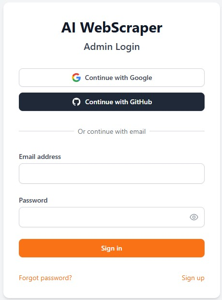
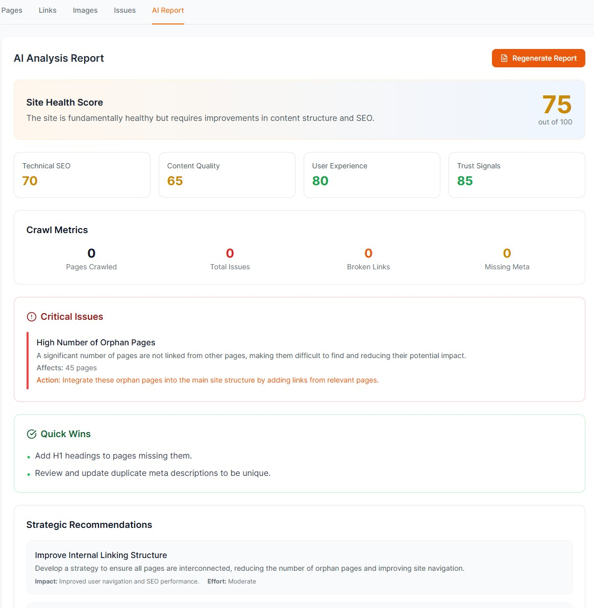

<div align="center">

# AI WebScraper

### Intelligent website crawling and SEO analysis with AI-powered insights

[](https://github.com/RCushmaniii/ai-webscraper)
[](LICENSE)
[](https://www.typescriptlang.org/)
[](https://www.python.org/)
[](https://github.com/RCushmaniii/ai-webscraper/actions/workflows/ci.yml)
[](https://github.com/RCushmaniii/ai-webscraper/actions/workflows/production-smoke.yml)

[**Live app**](https://scraper.cushlabs.ai) · [**Documentation**](docs/) · [**Report Bug**](https://github.com/RCushmaniii/ai-webscraper/issues)

| Login | AI Analysis Report |
|:-----:|:------------------:|
|  |  |

</div>

---

## Overview

AI WebScraper crawls websites, extracts SEO metadata, detects technical issues, and generates AI-powered analysis reports. Built for marketing teams and site owners who need actionable website insights without enterprise overhead.

### Key Results

- **1,150+ pages** crawled and analyzed in production testing
- **292+ links** extracted with automatic internal/external categorization
- **15-30 issues** detected per crawl across 9 SEO categories
- **Sub-2s page processing** with optimized batch operations

---

## Features

### Core Capabilities

| Feature | Benefit |
|---------|---------|
| **Intelligent Crawling** | Depth control, rate limiting, robots.txt compliance |
| **SEO Issue Detection** | 9 categories including missing titles, thin content, broken links |
| **AI-Powered Reports** | GPT-4 generated summaries with actionable recommendations |
| **Image Accessibility** | Automatic alt text detection for WCAG compliance |
| **Link Analysis** | Internal/external categorization with broken link detection |
| **JavaScript Rendering** | Firecrawl fallback for SPA pages that need a browser |

### Technical Highlights

- **Single-container backend** - crawls run as in-process async tasks, no queue or broker to operate
- **Row Level Security (RLS)** on all database tables
- **Distributed rate limiting** (Upstash Redis) on every mutating endpoint
- **Error monitoring** with Sentry on both frontend and backend
- **Two test gates**: CI before merge, a scheduled production smoke test after deploy
- **Tier-based access control** with free tier limits (3 crawls for free users)
- **Real-time monitoring** with automatic stale crawl detection

---

## Prerequisites

- **Node.js** 22 (check: `node -v`, see `.nvmrc`)
- **Python** 3.12 (check: `python --version`)
- **Supabase** account (free tier available) and the Supabase CLI for migrations
- **OpenAI API key** for AI features

---

## Quick Start

### 1. Clone & Install

```powershell
# Clone repository
git clone https://github.com/RCushmaniii/ai-webscraper.git
cd ai-webscraper

# Install frontend dependencies
cd frontend
npm install
cd ..

# Install backend dependencies
cd backend
python -m venv venv
.\venv\Scripts\activate
pip install -r requirements.txt
cd ..
```

### 2. Environment Setup

```powershell
# Create backend environment file
notepad backend\.env
```

Required backend variables:

```bash
# backend/.env
SUPABASE_URL=https://your-project.supabase.co
SUPABASE_KEY=your_supabase_anon_key
SUPABASE_SERVICE_ROLE_KEY=your_service_role_key
OPENAI_API_KEY=__YOUR_OPENAI_KEY__
```

Everything else (Upstash rate limiting, Sentry, Firecrawl, feature flags) is optional locally; see `backend/.env.example` for the full list.

```powershell
# Create frontend environment file
notepad frontend\.env
```

Required frontend variables:

```bash
# frontend/.env
REACT_APP_API_URL=http://localhost:8000/api/v1
REACT_APP_SUPABASE_URL=https://your-project.supabase.co
REACT_APP_SUPABASE_ANON_KEY=your_supabase_anon_key
```

### 3. Database Setup

1. Create a [Supabase](https://supabase.com) project
2. Link the project and push the migrations with the Supabase CLI:

```powershell
supabase link --project-ref __YOUR_PROJECT_REF__
```

```powershell
supabase db push
```

Migrations live in `supabase/migrations/`; `database/migrations/` holds the original base schema for reference.

### 4. Run Development Servers

```powershell
# Option A: Use startup script (recommended)
.\start.bat

# Option B: Manual startup (2 terminals)

# Terminal 1 - Backend API (crawls run in-process as background tasks)
cd backend
.\venv\Scripts\activate
uvicorn app.main:app --reload --host 0.0.0.0 --port 8000

# Terminal 2 - Frontend (Vite)
cd frontend
npm run dev
```

Access the application:

- **Frontend**: http://localhost:3000
- **Backend API**: http://localhost:8000
- **API Documentation**: http://localhost:8000/docs

---

## Project Structure

```
ai-webscraper/
├── backend/                    # FastAPI Python backend
│   ├── app/
│   │   ├── api/routes/        # API endpoint handlers
│   │   ├── core/              # Config, auth, domain blacklist
│   │   ├── models/            # Pydantic data models
│   │   └── services/          # Crawler, worker, issue detector
│   ├── requirements.txt       # Python dependencies
│   └── .env                   # Backend environment variables
│
├── frontend/                   # React TypeScript frontend
│   ├── src/
│   │   ├── components/        # Reusable UI components
│   │   ├── contexts/          # Auth context
│   │   ├── pages/             # Route pages
│   │   └── services/          # API client
│   ├── package.json           # Node dependencies
│   └── .env                   # Frontend environment variables
│
├── database/
│   └── migrations/            # SQL migration scripts
│
├── supabase/
│   └── migrations/            # Supabase-specific migrations
│
├── docs/                      # Additional documentation
├── start.bat                  # Windows startup script
├── CLAUDE.md                  # AI assistant context guide
└── README.md                  # This file
```

---

## Configuration

### Backend Environment Variables

| Variable | Description | Required |
|----------|-------------|----------|
| `SUPABASE_URL` | Supabase project URL | Yes |
| `SUPABASE_KEY` | Supabase anon key | Yes |
| `SUPABASE_SERVICE_ROLE_KEY` | Service role key (bypasses RLS) | Yes |
| `OPENAI_API_KEY` | OpenAI API key for AI features | Yes |
| `CORS_ORIGINS` | Comma-separated allowed origins (defaults per `ENVIRONMENT`) | No |
| `ENVIRONMENT` | `development` / `staging` / `production` | No |
| `UPSTASH_REDIS_REST_URL` / `UPSTASH_REDIS_REST_TOKEN` | Enables distributed rate limiting | Prod |
| `SENTRY_DSN` | Error monitoring | Prod |
| `FIRECRAWL_API_KEY` | JS rendering fallback for SPA pages | No |
| `ENABLE_LLM`, `ENABLE_SEO_AUDIT`, `ENABLE_BATCH_CRAWLS` | Feature flags (true/false) | No |
| `APP_VERSION` | Git SHA reported by `/api/v1/health/` (set by the Docker build) | No |

### Frontend Environment Variables

| Variable | Description | Required |
|----------|-------------|----------|
| `REACT_APP_API_URL` | Backend API base URL | Yes |
| `REACT_APP_SUPABASE_URL` | Supabase project URL | Yes |
| `REACT_APP_SUPABASE_ANON_KEY` | Supabase anon key | Yes |
| `REACT_APP_SENTRY_DSN` | Frontend error monitoring | Prod |
| `VITE_APP_VERSION` | Build-time git SHA stamped into `<meta name="app-version">` | Build |

---

## Performance

Measured on production workloads:

| Metric | Value |
|--------|-------|
| Pages per crawl | 1,150+ verified |
| Links extracted | 292+ per site |
| Images processed | 187+ with metadata |
| Issue detection | 15-30 issues per crawl |
| Crawl speed | 10-15x improvement after optimization |

---

## Security

- Row Level Security (RLS) on all database tables
- Service role separation for admin operations
- JWT-based authentication via Supabase Auth
- Rate limiting by user tier (Free: 3 crawls, Admin: unlimited)
- CORS configuration for production domains
- Domain blacklist prevents crawling social media and ad networks
- Input validation with Pydantic models

---

## User Tiers

| Feature | Free Tier | Admin |
|---------|-----------|-------|
| Crawls | 3 total | Unlimited |
| Pages per crawl | 100 | 1,000 |
| AI Reports | Yes | Yes |
| User Management | No | Yes |

Free users see their remaining crawls in the UI with an upgrade path.

---

## Testing

Two gates. CI (`.github/workflows/ci.yml`) runs on every PR and push to `main`; nothing merges without it. The production smoke test (`.github/workflows/production-smoke.yml`) runs twice a day against the live site and after every deploy.

**Before merge (CI):**

| Job | What it proves |
|-----|----------------|
| Backend tests | 125 pytest specs - crawler core, security (SSRF/blacklist), issue detector, models, Sentry filtering, plus HTTP smoke tests that boot the real app and assert health, security headers, the auth gate and CORS |
| Frontend | `tsc --noEmit`, 35 Vitest specs, and a production Vite build |

**After deploy (production smoke, `scripts/smoke-prod.sh`):** API health and version, hardening headers, anonymous access refused, frontend served with CSP and a loading bundle, and a drift check that warns when `main` has not been pulled onto the VPS yet.

Run locally:

```powershell
cd backend; python -m pytest tests/ -q
```

```powershell
cd frontend; npm test
```

```powershell
cd frontend; npx tsc --noEmit
```

---

## Deployment

Production runs on a Hetzner VPS behind Caddy at https://scraper.cushlabs.ai. There is no Vercel, Railway or Render in the loop.

- **Backend**: merging to `main` triggers `.github/workflows/build-image.yml`, which builds `backend/Dockerfile` (python:3.12-slim) and pushes `ghcr.io/rcushmaniii/ai-webscraper:latest`. The VPS pulls that image; it never builds.
- **Frontend**: built locally with Vite and copied to the Caddy static root.
- **Database**: Supabase; migrations are applied with `supabase db push`.

Both deploy scripts end by running the production smoke test with the SHA they just shipped, so a deploy that did not actually land fails loudly. They are bash scripts run from Git Bash (or by Claude):

```powershell
bash scripts/deploy-backend.sh
```

```powershell
bash scripts/deploy-frontend.sh
```

Full host details (paths, container name, Caddy config, logs) are in [CLAUDE.md](CLAUDE.md#deployment--hetzner-vps).

---

## Documentation

- **[CLAUDE.md](CLAUDE.md)** - AI assistant context, conventions and the Hetzner deployment runbook
- **[docs/SESSION_LOG.md](docs/SESSION_LOG.md)** - Working-session history
- **[docs/LLM_SERVICE.md](docs/LLM_SERVICE.md)** - AI analysis features
- **[docs/AI_REPORT_ARCHITECTURE.md](docs/AI_REPORT_ARCHITECTURE.md)** - Report pipeline
- **[database/README.md](database/README.md)** - Database schema
- **[docs/archive/](docs/archive/)** - Historical setup guides from the Render/Vercel era

---

## Roadmap

- [x] ~~Core crawling functionality~~
- [x] ~~SEO issue detection (9 categories)~~
- [x] ~~AI-powered report generation~~
- [x] ~~User tier system with crawl limits~~
- [ ] Pro tier with payment integration
- [ ] Multi-language support
- [ ] Scheduled recurring crawls
- [ ] White-label reporting

---

## Contributing

1. Fork the repository
2. Create feature branch (`git checkout -b feature/new-feature`)
3. Commit changes (`git commit -m 'Add new feature'`)
4. Push to branch (`git push origin feature/new-feature`)
5. Open Pull Request

---

## License

(c) 2026 Robert Cushman. All rights reserved. See [LICENSE](LICENSE) for details.

---

## Acknowledgments

- [FastAPI](https://fastapi.tiangolo.com/) - Python web framework
- [React](https://react.dev/) - UI library
- [Supabase](https://supabase.com/) - Backend infrastructure
- [Tailwind CSS](https://tailwindcss.com/) - Styling
- [OpenAI](https://openai.com/) - AI capabilities

---

## Contact

**Robert Cushman**
Business Solution Architect & Full-Stack Developer
Guadalajara, Mexico

info@cushlabs.ai
[GitHub](https://github.com/RCushmaniii) | [LinkedIn](https://linkedin.com/in/robert-cushman3) | [Portfolio](https://cushlabs.ai)

---

*Last Updated: 2026-03-10*
